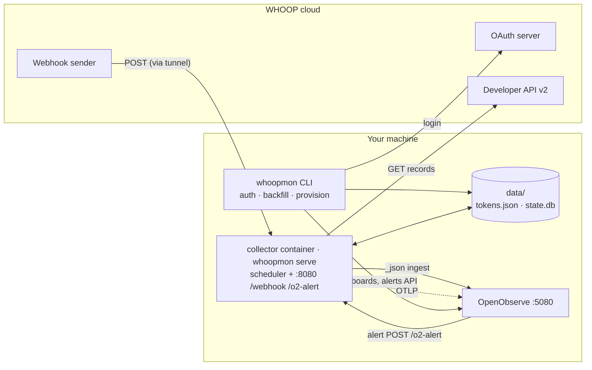
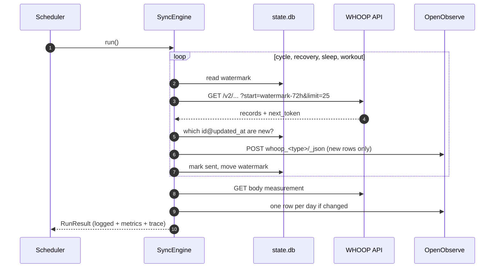
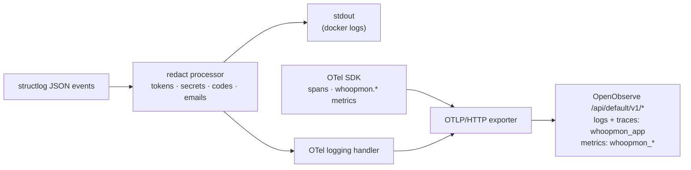

# Architecture

## Components



| Module | Job |
|---|---|
| `auth/` | OAuth login, callback server, token store with file lock and atomic write |
| `whoop/` | HTTP client (auth, 429, retries), pagination, resource catalog |
| `transform/` | Nested record → flat row; event time, local date, hours columns |
| `sinks/` | OpenObserve `_json` bulk ingest |
| `sync/` | Engine (watermarks, de-dup), scheduler, SQLite state |
| `webhook/` | HMAC check, de-dup by `trace_id`, queue, OpenObserve alert receiver |
| `provision/` | Dashboards and alerts as code |
| `observability/` | structlog, OTel traces/metrics/logs, redaction |

## One sync run



## OAuth login and token refresh

```mermaid
sequenceDiagram
  autonumber
  actor U as You
  participant C as whoopmon auth login
  participant B as Browser
  participant W as WHOOP OAuth
  participant T as data/tokens.json
  U->>C: make login
  C->>C: start callback server on :8765, random 32-char state
  C->>B: open /oauth2/auth (offline + read:* scopes)
  B->>W: sign in and approve
  W->>B: redirect to localhost:8765/callback?code&state
  B->>C: code, state
  C->>C: check state
  C->>W: POST /oauth2/token (authorization_code)
  W-->>C: access_token, refresh_token, expires_in
  C->>T: atomic write, mode 600 (Fernet-encrypted if TOKEN_ENCRYPTION_KEY is set)
  Note over C,W: Later, on a 401 or near expiry
  C->>W: POST /oauth2/token (refresh_token), under a file lock
  W-->>C: new pair; the old refresh token stops working at once
  C->>T: save the new pair before using it
```

## Telemetry



One trace per sync run, with a span per resource and per WHOOP request. Logs carry the trace
id, so a dashboard error leads to the log line and then to the trace. The schema is in
[LOGGING.md](LOGGING.md).

## Plan vs as built

The [design blueprint](https://claude.ai/artifact/BcXREg7aq1MptzmCFhrhJ3) (v0.1) was written
before the build. These are the places where the code chose differently, and why.

| Plan (v0.1) | As built (v1.0) | Why |
|---|---|---|
| APScheduler | A small fixed-interval loop (`sync/scheduler.py`, 900 s) | One job, no cron syntax needed; fewer dependencies |
| `tenacity` for retries | Retries inside the WHOOP client (401 refresh, 429 wait, 5xx backoff) | The rules depend on WHOOP's headers; easier to test in one place |
| `uv` + `uv.lock` | `pip install -e '.[dev]'` in a `.venv` via `make install` | Works with plain Python 3.12; CI uses the same path |
| Traces to the shared `default` stream | Traces to `whoopmon_app`, next to the logs | Collector traces are easy to find and don't mix with other services |
| 4 alerts (stale data, token fail, recovery, HRV) | 5 alerts: sync stalled and sync failed replace stale data | A failed run and a stalled scheduler need different fixes |
| `make backfill FROM=…` | `make backfill SINCE=…` | Matches the CLI flag |
| OpenObserve always in compose | OpenObserve behind the `o2` profile; default is your existing one | Most users already run OpenObserve, e.g. the playground |
| VRL helper functions in `openobserve/functions/` | Not built | Zone labels are done in dashboard SQL instead |

## Key decisions

| Decision | Reason | ADR |
|---|---|---|
| Python, one package, Typer CLI | Small codebase, good OTel and HTTP libraries | [0001](docs/adr/0001-python-collector.md) |
| Poll first, webhooks optional | No cycle webhooks exist; polling needs no public URL | [0002](docs/adr/0002-poll-first.md) |
| Append + `record_key` de-dup, latest-row SQL | OpenObserve has no update; WHOOP re-scores records | [0003](docs/adr/0003-append-and-dedupe.md) |
| `_timestamp` = event time | Time picker filters by when things happened | [0003](docs/adr/0003-append-and-dedupe.md) |

## Failure handling

| Failure | Behaviour |
|---|---|
| 401 | Refresh token once under a file lock, then retry |
| 429 | Wait `X-RateLimit-Reset` + 1 s, then retry (max 5) |
| 5xx / network | Exponential backoff with jitter, max 5 tries |
| OpenObserve rejects rows | Run fails; rows stay "unsent" and go again next run |
| Crash mid-run | Watermark and sent-keys move only after a write succeeds |
